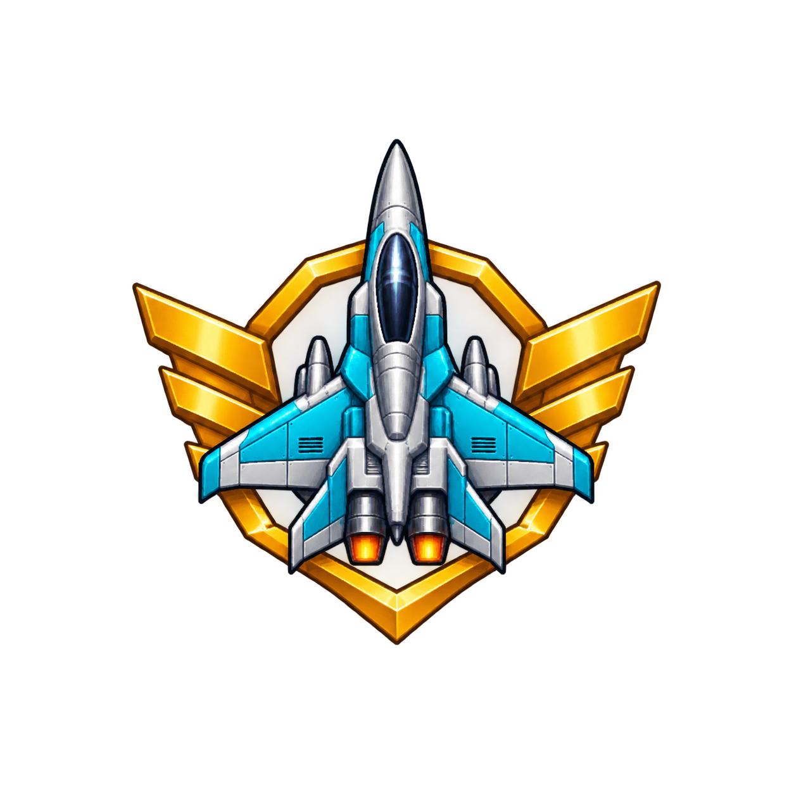
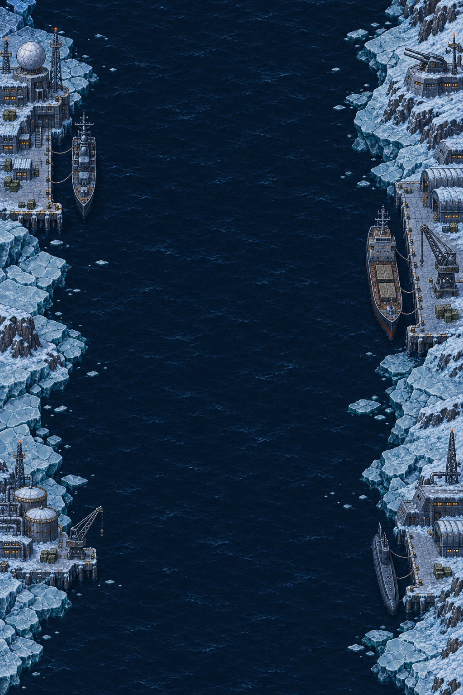
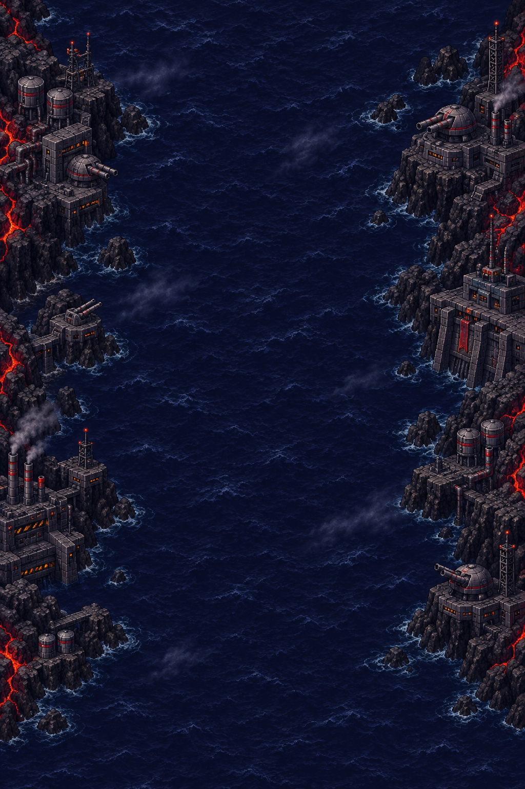

# Planex

Offline fullscreen Android arcade shooter built with Flutter and Flame.

## Download

[**Download Android APK v2.0.0-rc.1**](https://github.com/jhombalz/planex/releases/download/v2.0.0-rc.1/planex-v2.0.0-rc.1.apk)

Open on your phone, download the APK and allow installation from your browser when
Android prompts. This optimized **test candidate** retains the development signature
used by previous Planex test builds. Existing scores, aircraft, settings and progress
migrate automatically; old scores belong to Normal mode.

[All releases](https://github.com/jhombalz/planex/releases) |
[Previous v0.9.0 APK](https://github.com/jhombalz/planex/releases/download/v0.9.0-polish/planex-v0.9.0.apk)

## New in the v2 candidate

- **Six levels:** Coral Approach, Iron Harbor, Storm Citadel, Sunset Bastion,
  Frozen Convoy and Ember Fortress. Each has authored formations, a mid-level ace,
  a 45-second approach and its own boss movement and attack pattern.
- **Three aircraft:** cyan Swift handles quickly; bronze Striker starts at power 2
  and has stronger bombs; violet Wraith fires faster and keeps bonuses longer,
  with one starting bomb. Striker unlocks after level 1 and equips for level 2;
  Wraith unlocks after level 3 and equips for level 4.
- **Boss phases:** losing one turret changes attack pressure; losing both exposes
  the core and changes aimed fire. Pincer barrages, sweeping lanes and double
  helixes join fan, crossfire and spiral patterns.
- **Easy, Normal and Expert:** different health, shot speed and firing pressure,
  separate local leaderboards, and five starting lives on Easy.
- **Progress:** nine achievements, best bronze/silver/gold medals per level and
  difficulty, campaign-clear counts, combo scoring and projectile accuracy.
- **Recovery and learning:** a three-step first-flight guide, replayable tutorial,
  practice for reached levels, and saved checkpoints at campaign level starts.
  Continue restarts that level with saved resources, not a mid-level position.
  Practice never changes records or checkpoints.
- **New icons:** cyan aircraft/gold-wing launcher with adaptive, round and legacy
  Android variants, matching Android 12 splash and custom icon-only action buttons.






## Controls and bonuses

- Drag anywhere to steer; weapons fire automatically. Use a second finger for bombs.
- Pause is at the top right; bomb stock appears beside the bottom bomb icon.
  Buttons have tooltips/accessibility names. Android Back and interruptions pause
  play; resume explicitly. Left-handed, mute and sensitivity settings persist.
- Pulse is the default. Gold-ring drops grant temporary Laser, Homing Missiles or
  Plasma. Normal Swift/Striker bonuses last 18 seconds; Wraith gets 22. Easy adds
  two seconds; Expert removes two. Expiry, respawn and a new level restore Pulse.
- Bonus weapons drop randomly (12% per kill), every six kills, and for four kills
  inside a rolling three-second combo window. Nearby pickups attract to the plane.
- **P** raises power; **B** adds bombs. Every third kill drops a supply and every
  ninth drops a bomb supply. Maxed pickups award points.
- Bombs clear hostile bullets, damage enemies and grant temporary protection.
  Respawning removes one power level and grants a two-second shield.
- Gold medals require no damage and at least 50% projectile accuracy (or no
  projectile shots). Silver requires at most one hit; otherwise bronze.
  Laser ticks are excluded from projectile accuracy.

| Power | Pulse shots | Laser beams | Homing missiles | Plasma shots |
| --- | --- | --- | --- | --- |
| 1 | 1 | 1 | 1 | 1 |
| 2 | 2 | 2 | 2 | 2 |
| 3 | 3 | 3 | 3 | 3 |
| 4 | 5 | 4 | 4 | 5 |

Laser rendering and damage share beam positions. Beams pierce aligned enemies;
overlapping beams do not multiply damage to one target in a single tick.

## Combat and presentation

Every enemy has a health indicator. Boss UI separates shielded core health and
turrets. Aim cues precede shots; a warning precedes boss arrival. Hit flashes,
smoke, propellers, distinct weapon sounds and a 1.4-second boss destruction sequence
provide feedback. Reduced motion suppresses flashes and freezes scenery/propellers.
Projectile pools, bounded paint caches and downsampled scenery limit resource use.
Sprites preserve proportions on tall screens and controls respect cutouts.

## Artwork

Original aircraft, bosses and projectile PNGs are bundled in cached sprite atlases.
The v2 expansion, launcher and three new backgrounds were made with built-in
imagegen. Saved assets: [assets/images](assets/images). Exact v2 prompts:
[V2_ART_PROMPTS.txt](assets/V2_ART_PROMPTS.txt). See the original
[sprite prompt](assets/ART_PROMPT.txt), [scenery prompts](assets/SCENERY_PROMPTS.txt)
and [provenance](assets/LICENSE.txt). No sprites were extracted from the reference
arcade screenshot. Explosions and UI use code; audio is synthesized.

## Development and release

Phases 1-5 and the v2 feature expansion are implemented. Physical-phone acceptance,
balance/performance checks, production signing and store preparation remain before
stable v2. See [RELEASE_CHECKLIST.md](RELEASE_CHECKLIST.md).

Validation: static analysis reports no issues; 61 automated tests pass.
Automated checks cover combat, six-level progression, multibeam damage, save
migration, checkpoint recovery, practice isolation, mode leaderboards, medals,
achievements, tutorial controls, sprite rendering and a ten-minute headless combat
simulation. Simulation timing is not physical-device FPS.

```sh
flutter pub get
flutter analyze
flutter test
flutter build apk --release
```

APK: `build/app/outputs/flutter-apk/app-release.apk`.
Audio: `dart tool/generate_audio.dart`.
Launcher packaging: `tool/generate_android_icons.ps1`.
`DEVELOPMENT_GUIDE.md` is the original design reference; this README describes the
current Android implementation.
