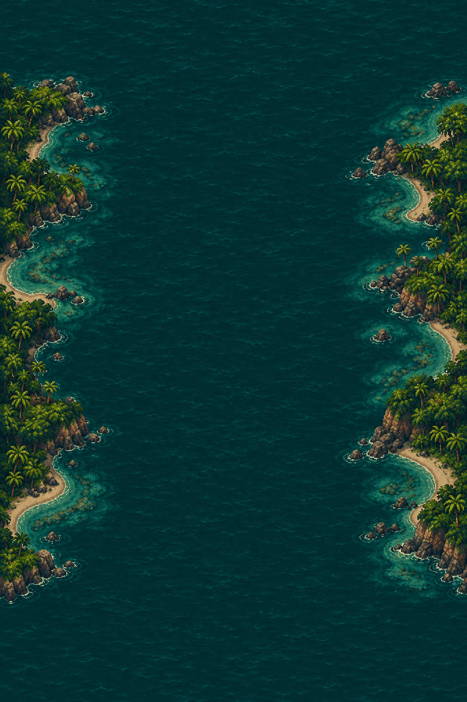
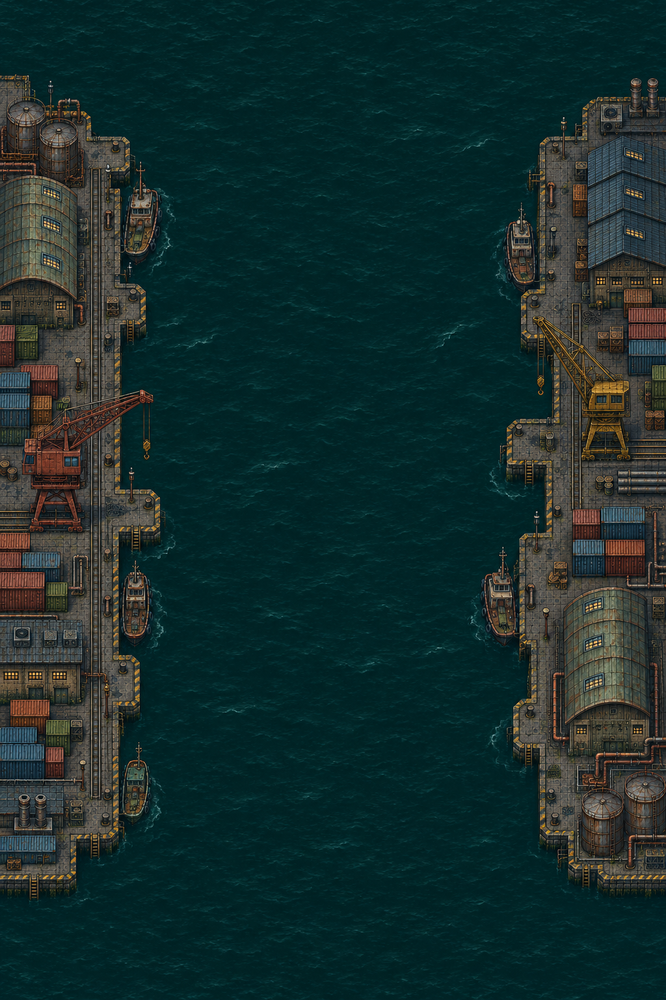
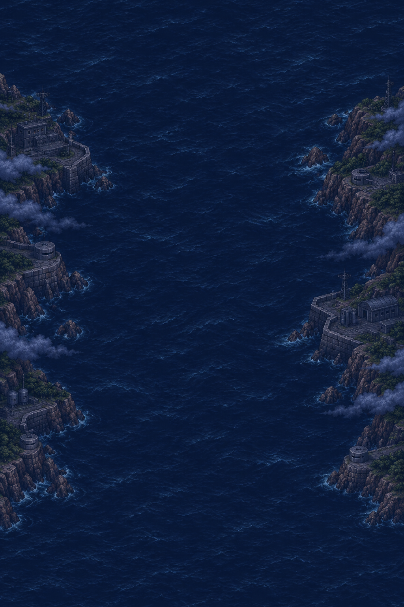

# Planex

Offline fullscreen Android arcade shooter built with Flutter and Flame.

## Download

[**Download Android APK v0.9.0**](https://github.com/jhombalz/planex/releases/download/v0.9.0-polish/planex-v0.9.0.apk)

Open the link on your phone, download the APK, then install it. Allow installation
from your browser when Android prompts. It installs over earlier Planex test builds
and retains scores, cleared levels, plane choice and settings. Legacy weapon
selections are ignored: every flight starts with Pulse.

This optimized test build uses development signing. Physical-phone validation of
immersive fullscreen, native audio, balancing and sustained performance is pending.

[All releases](https://github.com/jhombalz/planex/releases) ·
[Previous v0.8.0 APK](https://github.com/jhombalz/planex/releases/download/v0.8.0-bonus/planex-v0.8.0.apk)

## v0.9.0 polish update

All six recommended improvement areas were implemented before building this version:

1. **Fairer attacks:** enemies show a 300 ms firing cue and lock their aim before
   firing. Boss volleys have charge indicators. A three-second warning precedes
   boss arrival, and bosses do not shoot while entering behind the HUD.
2. **Scrolling scenery:** original tropical coastline, industrial harbor and storm
   island images replace the simple background shapes. The central channel stays
   dark for projectile readability. Images are decoded once at 512px width.
3. **Combat feedback:** brief hit flashes, impact sounds, damage smoke, animated
   propellers and distinct Pulse/Laser/Missile/Plasma sounds. Reduced motion
   suppresses flashes and freezes scenery/propeller animation.
4. **Pickup polish:** nearby drops attract toward the player, pickups announce
   their effect, and a three-second expiry warning accompanies the red bonus timer.
5. **Boss variety:** Reef Reaper uses a wide fan, Harbor Hammer alternates turret
   crossfire, and Storm Emperor fires rotating spirals. Each has different movement
   and a 1.4-second destruction sequence before level clear. The final boss has
   purple energy bursts; destruction cannot harm the player or score twice.
6. **Screen/performance polish:** aircraft and projectile images preserve their
   proportions on tall fullscreen displays. Controls respect cutouts. Sprite paint
   objects use a bounded cache, projectiles remain pooled, and a ten-minute headless
   combat simulation checks entity limits. Physical-device FPS/audio testing is
   still pending because no Android phone was connected.





The scenery was created with built-in imagegen. Original files are in
`assets/images/background_*.png`; exact prompts are in [SCENERY_PROMPTS.txt](assets/SCENERY_PROMPTS.txt).

## Controls and bonuses

- Drag anywhere to steer. Weapons fire automatically.
- Flight buttons are icons: pause at the top right and bomb near the bottom.
  The bomb badge shows your stock. Buttons retain tooltips/accessibility names.
- Pulse is always the default. Collect a gold-ring weapon drop for **18 seconds**
  of Laser, Homing Missiles or Plasma. Expiry, respawn and a new level restore Pulse.
  The small circular weapon indicator shows remaining bonus time; it is not a switch.
- Bonus drops have a 12% random kill chance, a guaranteed reward every six kills,
  and a reward for four kills within a rolling three-second combo window.
- Collect **P** for power, **B** for bombs. Power stays when a bonus expires.
  Every third kill drops a supply; every ninth kill drops a bomb supply.
- You have three lives. Respawn grants a two-second shield and removes one power
  level. Bombs clear hostile bullets, damage enemies and grant temporary protection.
- Pause also activates on Android Back or an app interruption. Resume explicitly
  with the play icon. Menus use play, next-level, replay and home icon actions.

### P upgrades

| Power | Pulse shots | Laser beams | Homing missiles | Plasma shots |
| --- | --- | --- | --- | --- |
| 1 | 1 | 1 | 1 | 1 |
| 2 | 2 | 2 | 2 | 2 |
| 3 | 3 | 3 | 3 | 3 |
| 4 | 5 | 4 | 4 | 5 |

Laser drawing and damage use the same beam positions. Beams pierce aligned
enemies; multiple overlapping beams do not multiply damage against a single
target in one tick. Power also increases bonus damage/beam width. Maxed pickups
award bonus points.

## Levels and aircraft

Clear Coral Approach, Iron Harbor and Storm Citadel. Each level has an authored
45-second approach followed by a multipart boss. Destroy both turrets to expose
the core. The boss display emphasizes core health/percentage, shield/enraged state
and two smaller turret indicators. Every regular enemy retains its own health bar.

Each level raises enemy health, movement speed, projectile speed and fire rate,
plus boss health and fan-fire frequency. Later levels also have more formations.

Reaching **level 2** permanently unlocks the bronze **Striker**, which is equipped
automatically for that level. It has amber projectile/laser effects and at least
power 2. Swift uses cyan effects and agile handling. Choose unlocked aircraft by
their icons in the hangar for future runs. Weapon bonuses are earned in combat,
not unlocked or selected in the hangar.

## Artwork

Aircraft, bosses, modules, bullets and weapons use bundled transparent PNG sprites
from one cached atlas. Runtime tinting distinguishes aircraft weapon effects.


The atlas was created with built-in imagegen using the supplied arcade screenshot
as a style reference. See the [prompt](assets/ART_PROMPT.txt),
[sprite index](assets/images/arcade_atlas.json) and [asset provenance](assets/LICENSE.txt).
Scenery uses bundled images; explosions and warning overlays are rendered in code.
Audio is synthesized and bundled.

## Development status and verification

Phases 1–5 are implemented. Phase 6 remains: device acceptance testing,
balancing/performance, production signing and AAB preparation.

For v0.9.0, analysis and all **53 automated tests** passed. Tests cover combat,
bonus collection/expiry, combo rewards, multibeam damage, P volley upgrades,
legacy-save migration, level-2 unlocks, icon controls, viewport sizing and pause.
Additional checks cover boss variants/destruction, firing cues, pickup attraction,
background wrap, image aspect ratios, cutouts and a ten-minute combat simulation.
The simulation report is written to `build/combat-soak.json`; its timing is not
a measurement of physical-device FPS. Phone-sized rendering was inspected.
Native system bars and audio still require
physical-device verification.

```sh
flutter pub get
flutter run
flutter analyze
flutter test
flutter build apk --release
```

APK: `build/app/outputs/flutter-apk/app-release.apk`.
Audio generator: `dart tool/generate_audio.dart`.
`DEVELOPMENT_GUIDE.md` is the original design reference; this README describes the
current Android implementation. In-progress runs do not survive process exit.
